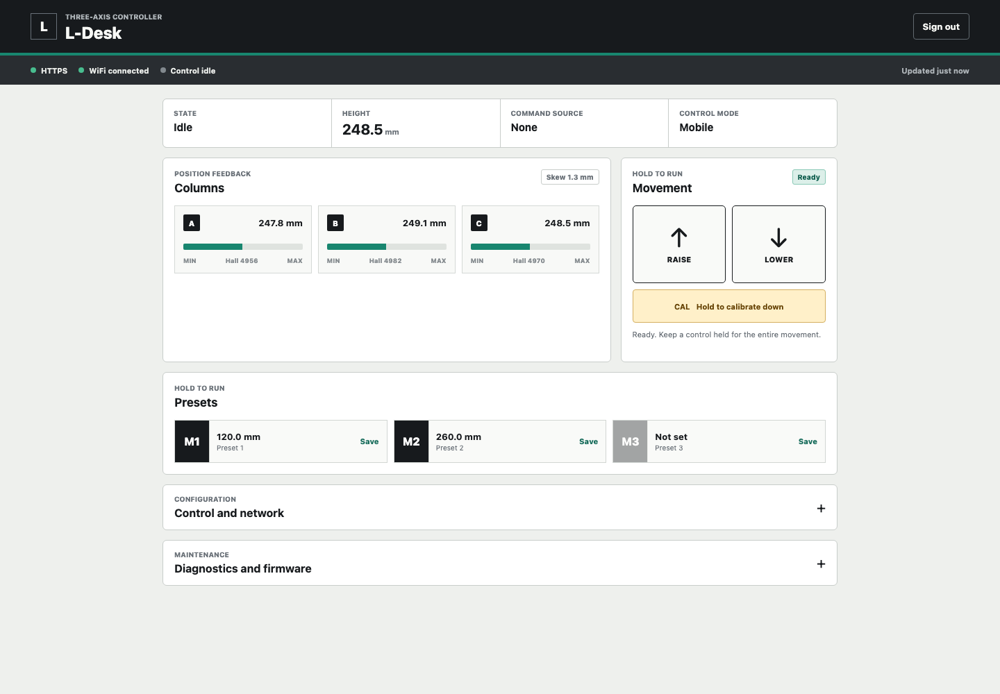

# L-Desk Firmware

[](../../actions/workflows/ci.yml)

[](https://docs.espressif.com/projects/esp-idf/en/v6.0/)
[](LICENSE)

ESP-IDF firmware for an L-shaped standing desk with three Hall-feedback
columns. The desk can run from physical buttons, a phone browser, or both. It
also provides calibration, synchronized motion, three presets, diagnostics,
and signed A/B firmware updates without a custom PCB or cloud service.

> [!CAUTION]
> This project controls heavy moving hardware. It is not a certified safety
> controller. Use a physical E-stop, a DC-rated contactor, fuses, mechanical
> hard stops, rigid guides, suitable wiring, and a documented commissioning
> process.



## Project Status

| Area | Firmware | Hardware work still required |
| --- | --- | --- |
| P1 manual motion and NC endstops | Implemented and host-tested | Verify wiring, E-stop, limits, and reversal on the desk |
| P2 Hall feedback and three-column leveling | Implemented and host-tested | Measure Hall scale, skew, load, stall, and thermal behavior |
| P3 hold-to-run presets | Implemented and host-tested | Verify target tolerance over the full load range |
| P4 diagnostics and signed A/B updates | Implemented and build-tested | Run power-loss, rollback, and recovery tests |
| P5A Wi-Fi and browser control | Implemented and integration-tested | Test LAN coverage, certificates, reconnects, and phone sleep |
| P5B BLE, MQTT, and Home Assistant | Deferred | Not part of the first hardware release |

The source, host tests, and ESP-IDF 6.0 release profile build successfully.
That does not make the assembled desk release-ready. The exact actuators,
drivers, PSU, frame, wiring, and enclosure must pass every
[commissioning check](docs/commissioning.md) before a release tag is created.

The firmware version comes from the Git revision and appears in the API and
browser console. CI generates the workflow and test badges. The
[latest GitHub release](../../releases/latest), when present, is the public
release record.

## Controls

The input mode can be changed from the browser:

| Mode | Physical buttons | Phone |
| --- | --- | --- |
| Buttons | Enabled | Status and maintenance only |
| Buttons + phone | Enabled | Enabled |
| Phone | Not required | Enabled |

Every movement is hold-to-run. Releasing a button or touch control sends STOP.
Phone movement also stops when the page loses focus, the screen locks, the
WebSocket closes, or its 250 ms command lease expires. The network sends
high-level requests to the application controller; it cannot address a GPIO or
motor directly.

The motion controller includes:

- three independently driven BTS7960 axes;
- `SAFE_START`, `UNREFERENCED`, `IDLE`, motion, calibration, and latched
  `ERROR` states;
- six NC endstops, monitored E-stop, reversal dead time, soft start, and
  bounded endstop alignment;
- PCNT quadrature capture, integer Hall scaling, direction/stall checks, trim,
  and a hard skew stop;
- downward calibration and three referenced height presets.

Boot and error reset never start movement.

## Reference Hardware

- ESP32-S3-DevKitC-1U-N8R8 with an external 2.4 GHz antenna
- Three matching 12 V, 500 mm linear actuators with quadrature Hall feedback
- Three matching BTS7960/IBT-2 modules
- Six NC upper/lower endstops
- Optional UP, DOWN, and CALIBRATE buttons
- Dual-contact latching NC E-stop and a correctly rated DC contactor
- Sized 12 V PSU, 12 V to 5 V regulator, and main/motor/logic fuses
- Rigid guided frame, enclosure, terminal blocks, ferrules, strain relief, and
  locking signal connectors

Read [hardware](docs/hardware.md), [electrical design](docs/electrical-design.md),
and the provisional [pinout](docs/pinout.md) before buying or wiring parts.
Never power an actuator or a BTS7960 motor rail from PC USB.

## First Start Without Buttons

Unconnected button inputs read as released because they use internal pull-ups.
A phone-only build can therefore leave `SAFE_START` without temporary motion
buttons.

1. Build one release for the device and store its generated credential record
   offline.
2. Commission Secure Boot and flash encryption with motor power disconnected.
3. Join the `Desk-XXXXXX` setup network using the generated credentials.
4. Open the desk's HTTPS address, enter its device code, and configure home
   Wi-Fi.
5. Hold **Calibrate** in the browser until all three lower endstops establish
   the Hall reference.
6. Set **Control inputs** to **Phone** if no local motion buttons are fitted.

The default is **Buttons + phone**. Resetting a fault rechecks the inputs,
returns to `SAFE_START`, and leaves all motors stopped. See
[networking](docs/networking.md) and
[control sources](docs/control-sources.md) for protocol details.

## Build and Test

Host tests use CTest with AddressSanitizer and UndefinedBehaviorSanitizer:

```sh
cmake -S tests -B build-host -DDESK_ENABLE_SANITIZERS=ON
cmake --build build-host --parallel
ASAN_OPTIONS=halt_on_error=1 UBSAN_OPTIONS=halt_on_error=1 \
  ctest --test-dir build-host --output-on-failure
```

The tests cover the domain state machine, fake-HAL application flows, motor
output sequencing, persistence records, network codecs, HTTP integration, web
contracts, and bounded input properties. CI rejects a stale test badge. See
[testing](docs/testing.md) for coverage and hardware gates.

Every image embeds a TLS identity and device code, including local builds.
Generate development-only material outside the repository before running
ESP-IDF:

```sh
mkdir -p "$TMPDIR/ldesk-dev"
openssl req -x509 -newkey rsa:2048 -nodes \
  -keyout "$TMPDIR/ldesk-dev/tls.key" \
  -out "$TMPDIR/ldesk-dev/tls.crt" \
  -subj "/CN=ldesk.local" -days 8
python3 tools/generate_build_secrets.py \
  --certificate "$TMPDIR/ldesk-dev/tls.crt" \
  --private-key "$TMPDIR/ldesk-dev/tls.key" \
  --output main/generated/desk_build_secrets.inc \
  --credentials-output "$TMPDIR/ldesk-dev/credentials.txt"
source "$HOME/.espressif/tools/activate_idf_v6.0.sh"
idf.py set-target esp32s3
idf.py build
```

Do not use these short-lived development credentials on the assembled desk.

## Release Image

A release build needs an RSA-3072 signing key, one TLS certificate/key pair per
desk, and an offline path for the generated device credentials:

```sh
tools/build_release.sh \
  --signing-key /secure/desk-signing.pem \
  --tls-certificate /secure/desk-fullchain.pem \
  --tls-private-key /secure/desk-private-key.pem \
  --credentials-output /secure/desk-device-credentials.txt
```

The script builds the release profile, signs and verifies the bootloader and
application, writes SHA-256 checksums, and removes generated secrets from the
working tree. It does not burn eFuses or flash the board.

The first protected flash changes device state and is partly irreversible.
Follow [device provisioning](docs/secure-deployment.md) with the exact board;
do not substitute an older `idf.py flash` procedure.

## Browser Access

The ESP32 serves HTTPS and WSS. Two deployment models are documented:

- **Direct LAN:** issue a per-device certificate from a private CA trusted by
  the phone and resolve a stable local hostname.
- **Reverse proxy:** keep the ESP32 on an isolated LAN and put Caddy or Nginx in
  front of it. The proxy can use a public hostname and renew a Let's Encrypt
  certificate while forwarding HTTPS and WSS.

Let's Encrypt does not issue certificates for `localhost`, and its short-lived
certificates should not be compiled into firmware. Do not expose the ESP32
directly to the Internet. The full topology is in
[networking](docs/networking.md).

## Architecture

```text
physical buttons / HTTPS-WSS browser
                 |
        bounded command arbiter
                 |
         application controller
                 |
      pure three-axis state machine
                 |
          injected HAL contract
                 |
 GPIO / LEDC / PCNT / NVS / Wi-Fi / OTA
```

Domain and HAL code contain no ESP-IDF, FreeRTOS, GPIO, or heap dependency.
Read [architecture](docs/architecture.md) for module boundaries and
[safety](docs/safety.md) for stop conditions and known limits.

## Repository Guide

- [Contributing](CONTRIBUTING.md)
- [Support](SUPPORT.md)
- [Security policy](SECURITY.md)
- [Code of conduct](CODE_OF_CONDUCT.md)
- [Governance](GOVERNANCE.md)
- [Changelog](CHANGELOG.md)
- [Release process](RELEASING.md)
- [Firmware bug form](../../issues/new?template=bug_report.yml)
- [Feature proposal form](../../issues/new?template=feature_request.yml)
- [Hardware compatibility form](../../issues/new?template=hardware_compatibility.yml)

## License

Copyright 2026 Alvaro Diago de Aguilar.

The code is available under the
[PolyForm Noncommercial License 1.0.0](LICENSE). Personal, hobby, educational,
research, charitable, and other permitted noncommercial uses are welcome.
Commercial use is not granted. The field-of-use restriction means this is a
source-available project, not OSI-approved open source.
